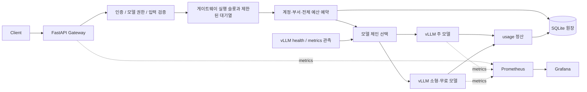

# 게이트웨이 설계와 API 정책

## 요청 흐름



게이트웨이는 추론 엔진을 별도 HTTP 프로세스로 사용합니다. 토큰별 연속 배치, KV 블록 할당과
선점은 vLLM이 수행하고, 게이트웨이는 요청 수용과 모델 선택을 담당합니다.
`LLM_CONCURRENCY`는 게이트웨이 요청 슬롯 수이며 vLLM의 `max_num_seqs`와 별도 설정입니다.

## API

| 경로 | 설명 | 인증 |
| --- | --- | --- |
| `POST /v1/chat/completions` | 일반 응답 또는 SSE 스트리밍 | Bearer API 키 |
| `GET /v1/models` | 접근 가능한 모델과 기본 별칭 | Bearer API 키 |
| `GET /v1/billing` | 본인 계정 월 집계와 최근 요청 20건 | Bearer API 키 |
| `GET /v1/admin/usage` | 계정·부서·전체 예산 집계 | `admin=true` 계정 |
| `GET /health/live` | 게이트웨이 프로세스 상태 | 없음 |
| `GET /health/ready` | 적어도 한 모델 서버의 health 성공 여부 | 없음 |
| `GET /metrics` | Prometheus 메트릭 | 없음 |

현재 채팅 API는 텍스트 메시지와 `n=1`을 지원합니다. 도구 호출·멀티모달·embeddings는
별도 확장 대상입니다. 요청의 추가 필드는 거절하며 원시 본문은 256 KiB로 제한합니다.

응답에는 다음 헤더가 포함됩니다.

| 헤더 | 의미 |
| --- | --- |
| `X-Request-ID` | 원장과 응답을 연결하는 서버 생성 ID |
| `X-Model-Used` | 실제 응답 모델 |
| `X-LLM-Backend` | 설정한 backend 이름 |
| `X-Fallback` | 장애·큐·예산으로 전환했는지 여부 |
| `X-Routing-Reason` | `preferred`, `queue`, `unavailable`, `budget` |
| `X-Charged-Micro-USD` | 비스트리밍 요청의 최종 정산액 |

SSE의 최종 금액은 `/v1/billing`에서 request ID로 확인합니다. 요청 시
`stream_options.include_usage=false`를 지정하면 클라이언트용 usage 이벤트를 숨기되 내부 정산은
계속 수행합니다. gateway는 항상 upstream에 최종 usage를 요청합니다.

## 모델 체인과 권한

`.env.llm.example`의 primary/fallback 변수는 두 서버를 간단히 연결하는 방법입니다.
더 긴 체인은 `LLM_BACKENDS` JSON으로 지정합니다.

```dotenv
LLM_BACKENDS=[{"name":"large","url":"http://127.0.0.1:8001","model":"qwen-large","api_key":"local-vllm-primary","priority":0,"input_price":2,"output_price":6,"max_queue":10},{"name":"small","url":"http://127.0.0.1:8002","model":"qwen-small","api_key":"local-vllm-fallback","priority":1,"input_price":0,"output_price":0,"max_queue":10}]
```

우선순위가 낮은 숫자부터 시도합니다. 기본 별칭 `LLM_MODEL=local-model`로 호출하면 체인을
사용하고, 등록된 실제 모델 이름을 지정하면 해당 backend부터 시도합니다.
API 키별 `allowed_models`가 비어 있으면 모든 등록 모델에 접근할 수 있습니다.
목록이 있으면 라우팅·폴백·예산 강등에도 동일한 권한을 적용합니다.

`LLM_HEALTH_POLL_INTERVAL_SECONDS` 기본값은 5초입니다. `/health`와 `/metrics`를 읽고,
`vllm:num_requests_waiting`이 backend의 `max_queue`를 넘으면 다음 모델로 우회합니다.
여러 엔진의 대기열 값은 합산합니다. 관측값이 3회 poll 간격보다 오래되었거나 대기열 값이
없거나 유효하지 않으면 가용한 빈 큐로 간주하지 않습니다. 값 0을 지정하면 관측을 끄고
HTTP 연결 실패·429·5xx에 따른 폴백만 사용합니다.

주 서버 장애 시 기본적으로 3회 연속 실패 후 circuit을 열고 15초 뒤 요청 한 건으로
복구를 확인합니다. 모델 서버의 429/5xx 및 연결 실패는 다음 모델을 시도합니다.
read/write timeout이나 이미 시작한 스트림의 오류는 생성 여부가 불확실하므로 재생성하지 않습니다.

게이트웨이 전체 처리 용량까지 소진되면 429와 `Retry-After`를 반환합니다.
이는 특정 vLLM 모델의 큐가 길어서 다른 모델로 우회하는 정책과 별개의 최종 backpressure입니다.

## 과금과 월 예산

금액은 정수 `micro_usd`입니다. `1 USD = 1,000,000 micro_usd`이며, 입력 단가 2와 출력 단가 6은
각각 100만 토큰당 $2/$6에 해당하는 예제 내부 요금입니다. 외부 결제 청구 기능은 없습니다.

```text
예약액 = context_limit × 체인 최대 입력 단가 + max_tokens × 체인 최대 출력 단가
정산액 = usage.prompt_tokens × 실제 모델 입력 단가 + usage.completion_tokens × 실제 모델 출력 단가
```

예약은 토크나이저·chat template 차이와 동시 요청의 예산 초과를 막기 위한 보수적 상한입니다.
실제 입력이 짧더라도 남은 예산이 이 상한보다 작으면 무료 모델로 전환될 수 있습니다.
모든 backend의 실제 context 길이는 `LLM_CONTEXT_LIMIT`과 맞춰야 합니다.

`LLM_ACCOUNTS` 각 항목에 `department`를 넣고 `LLM_DEPARTMENT_BUDGETS`에 부서 예산을
지정하면 여러 계정이 부서 예산을 공유합니다. 부서 정보가 없거나 해당 부서 예산이 없으면
계정과 전체 예산만 적용합니다. 예산 확인과 예약은 하나의 SQLite `BEGIN IMMEDIATE`
트랜잭션에서 수행합니다.

예산이 부족하면 입력·출력 단가가 모두 0인 모델만 남겨 다시 라우팅합니다.
무료 요청도 토큰 수와 모델을 원장에 기록합니다. 권한이 허용된 무료 모델이 없으면 402,
무료 모델이 설정되었지만 모두 사용할 수 없으면 503입니다.

원장 상태는 `pending`, `settled`, `released`, `uncertain`입니다. 정상 응답은 실제 토큰으로
정산한 뒤 예약 차액을 반환합니다. 명확한 생성 전 실패는 해제하고, 타임아웃·중단·usage 오류는
예약을 유지합니다. 재시작해도 미해결 예약은 사라지지 않습니다.
UTC 달력 월을 기준으로 집계하고 월말 요청은 예약한 달에 정산합니다.
프롬프트와 응답 본문은 원장에 저장하지 않습니다.

`pending`/`uncertain`은 모델 로그와 대조해 운영자가 정산해야 합니다. 자동 만료나 예산 초기화
API는 없습니다. 클라이언트 재요청은 새로운 생성이며 별도 요청으로 기록됩니다.
요금은 최종 고객 응답 토큰 기준으로, 실패한 모델 시도의 GPU 원가까지 계산하지는 않습니다.

## SSE와 자원 정리

인증·예산·큐·upstream 연결 검사를 HTTP 헤더 전송 전에 수행합니다.
정상 스트림은 최종 usage를 검증하고 원장 정산을 완료한 후 `[DONE]`을 보냅니다.
도중 오류는 SSE error 이벤트로 알리고 성공 `[DONE]`을 보내지 않습니다.
클라이언트 연결 종료 시 upstream 응답과 실행 슬롯을 닫으며 미정산 예약을 유지합니다.
부분 응답 이후 다른 모델로 다시 생성하는 동작은 하지 않습니다.

## 모델 버전 비교

`LLM_CANARY_BACKEND`에 등록 backend 이름을, `LLM_CANARY_RATIO`에 0~1 비율을 설정하면
기본 모델 별칭 요청을 사용자별로 일정하게 분배합니다. SHA-256을 사용해 프로세스가 재시작해도
같은 사용자의 배정이 유지됩니다. 실제 모델 이름과 backend는 정산 원장에 기록합니다.
설정 변경은 재시작으로 적용하며 런타임 변경 API와 품질 피드백 수집은 별도 확장 대상입니다.

## KV 캐시와 모니터링

Compose는 prefix caching, chunked prefill을 활성화하고 다음 값을 노출합니다.

| 설정 | 기본값 |
| --- | --- |
| `LLM_CONTEXT_LIMIT` | 4096 |
| `VLLM_GPU_MEMORY_UTILIZATION` | 0.85 |
| `VLLM_FALLBACK_GPU_MEMORY_UTILIZATION` | 0.85 |
| `VLLM_KV_CACHE_DTYPE` | auto |
| `VLLM_BLOCK_SIZE` | 16 |
| `VLLM_MAX_NUM_SEQS` | 8 |
| `VLLM_MAX_NUM_BATCHED_TOKENS` | 4096 |

KV 캐시는 backend별로 독립적입니다. 장애 시 생성 중인 KV 캐시를 다른 모델로 옮기지 않습니다.
게이트웨이의 금액 예약과 GPU KV 메모리 예약은 서로 다른 개념입니다.
캐시 적중 할인 없이 서버가 반환하는 전체 `prompt_tokens`를 과금합니다.

Grafana는 gateway 큐·거절률·라우팅 시도·지연·토큰·예산과 vLLM KV 사용률·prefix 적중률·
엔진 큐·TTFT·preemption을 표시합니다. 경보 규칙은 서버 다운·게이트웨이 과부하·예산 거절·
잔여 전체 예산 10% 미만을 감지합니다. 외부 알림 발송에는 별도 Alertmanager 설정이 필요합니다.

## 배포 범위

현재 실행 구성은 단일 gateway 인스턴스와 단일 worker를 사용합니다.
여러 인스턴스로 늘릴 때는 공유 admission과 과금 저장소를 설계해야 합니다.
API 키 인증과 SQLite는 로컬 개발용 기본 구현입니다. 사내 SSO를 연결하려면 Authentik OIDC
검증 및 사용자 매핑을, 운영 DB로 옮기려면 PostgreSQL 어댑터와 마이그레이션을 추가합니다.
클라우드 overflow는 연결하지 않아 요청이 자동으로 외부 LLM 서비스에 전송되지는 않습니다.

확인한 vLLM 버전은 0.11.2입니다.
[엔진 설정](https://docs.vllm.ai/en/v0.11.2/configuration/engine_args/) ·
[서빙 API](https://docs.vllm.ai/en/v0.11.2/serving/openai_compatible_server/) ·
[스케줄러 최적화](https://docs.vllm.ai/en/v0.11.2/configuration/optimization/) ·
[V1 메트릭](https://docs.vllm.ai/en/v0.11.2/design/metrics/)
